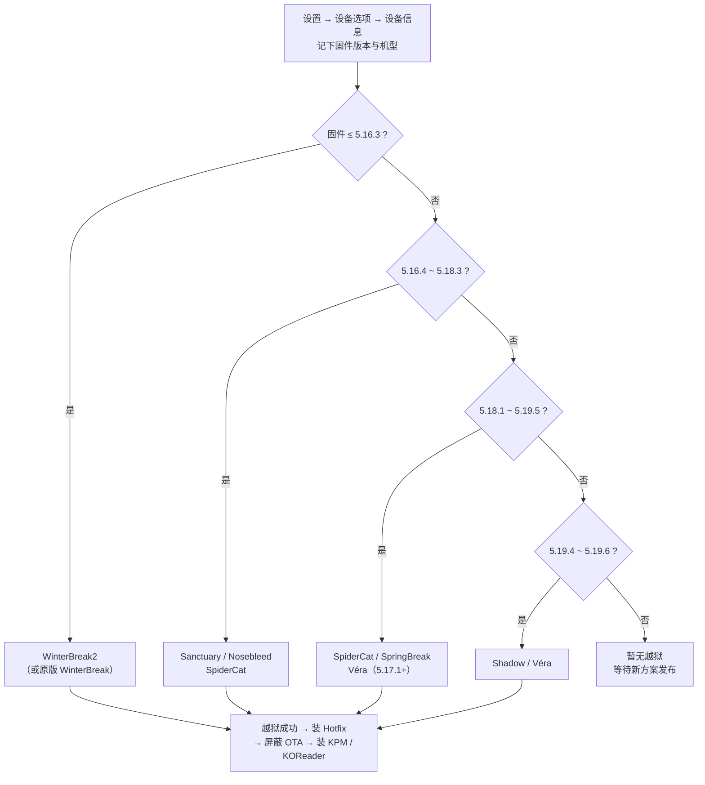

<div align="center">


# 🐧 Awesome Kindle

### Kindle 越狱 · 刷机 · 玩法完全索引

**把全网开源、优质的 Kindle 折腾资源，收进一个仓库。**

[](https://awesome.re)
[](LICENSE)
[](#-贡献指南)


**🌐 语言：** **简体中文** · [English](README_EN.md)

> **越狱只是"打开一扇门"，不是刷系统。**
> 打开这扇门之后，你可以在 Kindle 上跑 [KOReader](https://github.com/koreader/koreader)、终端、Alpine Linux、甚至 Android —— 而 Kindle 商店、Kindle Unlimited 等原有功能完全不受影响。

[🚀 我该用哪个越狱](#-我该用哪个越狱) · [🔓 越狱方案总览](#-越狱方案总览) · [🧰 越狱后生态](#-越狱后生态) · [🧱 固件与救砖](#-固件与救砖) · [📱 机型速查](#-机型速查表) · [❓ FAQ](#-faq--排错)

</div>

---

## 📖 目录

- [这是什么](#-这是什么)
- [📌 使用前必读](#-使用前必读)
- [⚖️ 为什么要越狱](#️-为什么要越狱以及它不是什么)
- [🚀 我该用哪个越狱](#-我该用哪个越狱)
- [⚡ 5 分钟快速开始](#-5-分钟快速开始)
- [🔍 如何识别你的机型与固件](#-如何识别你的机型与固件)
- [🔓 越狱方案总览](#-越狱方案总览)
- [📋 越狱前准备清单](#-越狱前准备清单)
- [🧩 主流越狱详解](#-主流越狱详解)
  - [WinterBreak2](#winterbreak2)
  - [WinterBreak](#winterbreak)
  - [SpiderCat](#spidercat)
  - [Véra](#véra)
  - [Nosebleed](#nosebleed)
  - [Sanctuary](#sanctuary)
  - [SpringBreak（WinterBreak3）](#springbreakwinterbreak3)
  - [Shadow](#shadow)
  - [AdBreak](#adbreak)
  - [LanguageBreak / 上古机型](#languagebreak--上古机型)
- [🧰 越狱后生态](#-越狱后生态)
  - [必备三件套：Hotfix / KPM / Jobman](#-必备三件套hotfix--kpm--jobman)
  - [KOReader：灵魂应用](#-koreader灵魂应用)
  - [终端 / SSH / Linux](#-终端--ssh--linux)
  - [旧的 KUAL / MRPI 体系](#-旧的-kual--mrpi-体系)
- [📚 阅读与书库工具](#-阅读与书库工具)
- [🎮 应用与游戏清单](#-应用与游戏清单)
- [🛠️ 进阶玩法](#️-进阶玩法)
- [🧑‍💻 开发者资源](#-开发者资源)
- [🧱 固件与救砖](#-固件与救砖)
- [📱 机型速查表](#-机型速查表)
- [🧭 术语表](#-术语表)
- [❓ FAQ / 排错](#-faq--排错)
- [🌐 社区资源](#-社区资源)
- [🤝 贡献指南](#-贡献指南)
- [🙏 致谢](#-致谢)
- [📄 License](#-license)

---

## 🔎 这是什么

这是一个**持续更新、面向所有 Kindle 用户的开放索引**。它汇总了：

- 🔓 **所有主流的开源越狱方案**（按机型、固件版本精确对应）
- 🧰 **越狱后的完整生态**：包管理器、热修复、阅读器、终端、Linux、Android
- 📚 **优质开源应用与工具**：阅读、书库、转换、笔记、音频、游戏
- 🧱 **刷机与救砖**：固件下载、降级、串口刷机、恢复出厂
- 🧑‍💻 **开发者入口**：SDK、交叉编译工具链、脚本机制、系统文档

> [!NOTE]
> 本仓库是**索引与导航**，不托管任何破解版书籍、固件或闭源商业软件。所有越狱工具均来自其官方开源仓库 / 官方 Wiki。
> 一切操作以 [KindleModding 官方 Wiki](https://kindlemodding.org/) 与 [Jailbreak Wizard](https://kindlemodding.org/jailbreak-wizard.html) 为最终依据 —— 本仓库若与官方冲突，**永远以官方为准**。

---

## 📌 使用前必读

> [!WARNING]
> 越狱有风险，操作需谨慎。**刷机、降级、串口操作属于高风险行为**，可能变砖。请务必：
> 1. 先在 [Jailbreak Wizard](https://kindlemodding.org/jailbreak-wizard.html) 确认你的 **机型 + 固件** 有可用方案；
> 2. 仔细阅读对应越狱页面 **全文**；
> 3. **不要**在没搞懂的情况下恢复出厂 / 降级 / 拔线；
> 4. 出问题优先问官方 Discord / r/kindlejailbreak，而不是盲目尝试。

几句大实话，能帮你少走 90% 的弯路：

| 误区 | 真相 |
| --- | --- |
| "越狱 = 刷系统 / 装系统" | ❌ 越狱只是**获得运行外部代码的权限**，像 Android root、iOS 越狱。它本身不是固件，也不能"安装"。 |
| "越狱就能免费看书" | ❌ 越狱和盗版是两码事。**越狱不会、也不能**让 Amazon 商店的书免费。 |
| "我可以先升级再降级回来" | ❌ **没有越狱就无法降级**。固件只能升不能降（除非已越狱或用串口）。 |
| "升级系统后越狱还在" | ❌ OTA 升级会**抹掉越狱**。越狱后必须装 Hotfix 并**屏蔽自动更新**。 |
| "哪个越狱最好" | ⚖️ 本质都一样，只是针对不同固件的**不同方法**。你不存在"升级越狱"这回事，只有一个当前能用的。 |
| "买台新 Kindle 专门越狱" | ⚠️ 可能翻车：新机出厂固件很可能**尚无越狱**。买前先查固件版本。 |

---

## ⚖️ 为什么要越狱（以及它不是什么）

**越狱能带来的（Pros）**

- 📖 装 **KOReader**，获得高度可定制的阅读体验（排版、词典、笔记、云同步）
- ⌨️ 用蓝牙做**翻页器 / 键盘**，把墨水屏变成写作设备
- 💻 **终端、SSH、Alpine Linux、VNC**、改屏保、改浏览器
- 🧑‍💻 学习为 Kindle 开发应用，公开文档非常齐全
- 🎮 玩 Wordle / 象棋 / 扫雷（甚至 DOOM、在 Kindle 上跑 Minecraft 服务器）

**代价与限制（Cons）**

- 可能买到出厂即"无解"固件的机器，买前务必查版本
- 某些 tweak 可能有性能 / 卡顿问题（这是 tweak 的事，不是越狱本身）
- 你大概会被朋友当成"那个在 Kindle 上玩 DOOM 的怪人"
- 操作风险由你自己承担

**它不是什么**

- ❌ 不是刷系统、不是换固件
- ❌ 不是盗版，也不会让商店的书免费
- ❌ 不是"一劳永逸"：OTA 会覆盖，必须装 **Hotfix** 并**屏蔽自动更新**

---

## 🚀 我该用哪个越狱

**唯一权威入口 👉 [kindlemodding.org/jailbreak-wizard](https://kindlemodding.org/jailbreak-wizard.html)**
（输入序列号 / 机型 + 固件，自动告诉你该用哪个方案。）

下面是简化的决策流程（仅作理解用，**最终以 Wizard 为准**）：



> [!TIP]
> - **广告版机型**（锁屏有广告）在部分固件上需要走 [AdBreak](https://kindlemodding.org/jailbreaking/AdBreak/)。
> - **5.18.1 及以上**：老牌的 WinterBreak / Mesquito 体系**已失效**，请用 SpiderCat / SpringBreak / Véra / Shadow 等新方案。
> - 2025–2026 年的 **Kindle Scribe 3 / Scribe Colorsoft / 2026 款 Kindle / 2026 款 Paperwhite** 目前**暂无越狱**。

---

## ⚡ 5 分钟快速开始

> 给"只想快点搞定"的人。高风险细节仍请读对应页全文。

1. **查固件**：`设置 → 设备选项 → 设备信息`，记下**机型 + 完整固件版本**。
2. **查方案**：打开 [Jailbreak Wizard](https://kindlemodding.org/jailbreak-wizard.html)，确认你的组合有可用越狱。
3. **做准备**：**填满存储 + 关 Wi-Fi**（防止 OTA 中途毁掉越狱），删除根目录 `.bin`。
4. **跑越狱**：按对应方案操作（WinterBreak2 / SpiderCat / Véra / Shadow …）。
5. **装 Hotfix**：越狱成功后**第一件事**——它防 OTA、防变砖。
6. **装 KPM → KOReader**：用 KPM 装 KOReader 和喜欢的应用，开始读。

> 全程只认官方 Wiki。卡住了就去官方 Discord，别硬来。

---

## 🔍 如何识别你的机型与固件

| 你想知道 | 怎么查 |
| --- | --- |
| **固件版本** | `设置 → 设备选项 → 设备信息`，形如 `5.16.2.1.1`（小数位越多越精确） |
| **机型代号** | 同页可见（如 PW5 / KT5 / KOA3 / KS）；也可从序列号前缀判断，见[机型表](https://kindlemodding.org/kindle-hacking/models-table.html) |
| **是否广告版** | Amazon 账号页查看 Special Offers 是否开启（广告版部分固件需走 AdBreak） |
| **拿不准** | 直接用 [Jailbreak Wizard](https://kindlemodding.org/jailbreak-wizard.html) 输入序列号 / 机型 + 固件 |

---

## 🔓 越狱方案总览

> 数据整理自 [KindleModding 官方 jailbreaks.json 兼容矩阵](https://kindlemodding.org/jailbreaks.json)（随时可能更新）。
> "是否需要注册"= 是否需要登录 Amazon 账号；"广告版"= 是否仅支持带 Special Offers 的机器。

| 方案 | 适用固件 | 适用机型 | 注册 | 广告版 | 状态 | 链接 |
| --- | --- | --- | :---: | :---: | :---: | --- |
| **WinterBreak2** | ≤ 5.16.3（另接受 5.16.5） | PW / PW2 / KV / KT2 / PW3 / KOA / KT3 / KOA2 / PW4 / KT4 / KOA3 / PW5 / KT5 / KS | 否 | 否 | ✅ 活跃 | [Wiki](https://kindlemodding.org/jailbreaking/WinterBreak2/) · [Repo](https://github.com/KindleModding/Winterbreak2) |
| **WinterBreak** | 5.16.2.1.1 ~ 5.17.x（< 5.18.1） | 同上，含 PW6 / KS2 / CS | **是** | 否 | ✅ 活跃 | [Wiki](https://kindlemodding.org/jailbreaking/WinterBreak/) · [Repo](https://github.com/KindleModding/WinterBreak) |
| **SpiderCat** | 5.16.3 ~ 5.19.5 | PW4 / KT4 / KOA3 / PW5 / KT5 / KT6 / PW6 / CS / KS / KS2 | 否 | 否 | ✅ 活跃 | [Wiki](https://kindlemodding.org/jailbreaking/SpiderCat/) · [Repo](https://github.com/KindleModding/SpiderCat) |
| **Véra** | 5.17.1 ~ 5.20.2 | PW5 / KT5 / KT6 / PW6 / CS / KS / KS2 | 否 | 否 | ✅ 活跃 | [Wiki](https://kindlemodding.org/jailbreaking/Vera/) |
| **Nosebleed** | 5.16.4 ~ 5.18.6（KT5/PW5/KOA3）<br/>5.16.4 ~ 5.17.1.0.4（PW6/KT6） | KT5 / PW5 / KOA3 / PW6 / KT6 | 否 | 否 | ✅ 活跃 | [Wiki](https://kindlemodding.org/jailbreaking/Nosebleed/) |
| **Sanctuary** | 5.16.4 ~ 5.18.3（拒绝 5.16.5） | PW4 / KT4 / KOA3 / PW5 / KT5 / KS / KT6 / PW6 / KS2 / CS | 否 | 否 | ✅ 活跃 | [Wiki](https://kindlemodding.org/jailbreaking/Sanctuary/) |
| **SpringBreak**（WinterBreak3） | 5.18.1 ~ 5.19.2.0.1（KT5/PW5）<br/>5.18.1.1.1（KT4/PW4） | KT5 / PW5 / KT4 / PW4 | **是** | 否 | ✅ 活跃 | [Wiki](https://kindlemodding.org/jailbreaking/SpringBreak/) · [Repo](https://github.com/KindleModding/SpringBreak) |
| **Shadow** | 5.19.4 ~ 5.19.6 | KS / KS2 / CS / PW6 / KT6 | 否 | 否 | ✅ 活跃 | [Wiki](https://kindlemodding.org/jailbreaking/Shadow/) · [Repo](https://github.com/KindleModding/Shadow) |
| **AdBreak** | 5.18.1 ~ 5.18.5.0.1 | PW4 / KT4 / KOA3 / PW5 / KT5 / KS / KT6 / PW6 | **是** | **仅广告版** | 🧪 实验 | [Wiki](https://kindlemodding.org/jailbreaking/AdBreak/) · [Repo](https://github.com/KindleModding/AdBreak) |
| **LanguageBreak** | ≤ 5.16.2.1.1 | 旧款主流机型 | 否 | 否 | 🗄️ 归档 | [Wiki](https://kindlemodding.org/jailbreaking/Legacy/LanguageBreak.html) · [Repo](https://github.com/KindleModding/LanguageBreak) |
| **NiLuJe K2/K4/K5** | 2.x / 4.x / 5.0.x | K2 / DX / K3 / K4 / KT | 否 | 否 | 🗄️ 经典 | [Legacy](https://kindlemodding.org/jailbreaking/Legacy/index.html) |
| **Android 刷机** | — | 部分机型 / Kindle × Migu | — | — | 🧪 硬核 | [指南](https://github.com/Ooonana/Guide-to-installing-android-on-kindle) |

---

## 📋 越狱前准备清单

按顺序做，能救命：

1. **查固件版本**：`设置 → 设备选项 → 设备信息`，记下完整版本号（如 `5.16.2.1.1`）与机型代号。
2. **填满 Kindle（防自动更新）**：越狱过程常需联网，Amazon 可能中途推送 OTA 直接毁掉越狱。用大文件（电影等）把存储塞满，或参考 [Prevent Automatic Updates](https://kindlemodding.org/jailbreaking/prevent-auto-update/)。
3. **关闭 Wi-Fi / 开启飞行模式**：在关键步骤（尤其是触发漏洞时）断开网络，除非方案明确要求联网。
4. **删除根目录下的 `.bin` 更新包**：越狱完成后务必删除，防止重启时自动安装。
5. **用官方 Wizard 复核**：`机型 + 固件` 与方案必须严格匹配，差一个小版本都可能失败。
6. **（可选）备份**：老机型可参考 [Backing Up](https://kindlemodding.org/jailbreaking/Legacy/backing-up/index.html)；新款主要靠云同步书库，越狱本身不动用户数据。
7. **充满电 + 用可靠数据线**：别在关键时刻断电。

---

## 🧩 主流越狱详解

> 每节只讲"原理 + 关键步骤 + 注意点"，**完整图文步骤务必看官方 Wiki 原文**。

### WinterBreak2

- **原理**：利用系统内置浏览器 / 书籍解析的漏洞触发提权，**免 Mesquito 框架**，比初代更轻量。
- **适用范围**：≤ 5.16.3（并接受 5.16.5），覆盖从 PW 到 Colorsoft 的大量机型。
- **关键步骤**：
  1. 把 `wb2.zip` 解压到 Kindle 根目录（确保出现 `winterbreak2` 文件夹）；
  2. 打开实验浏览器，访问 `https://penguins184.xyz/wb2`；
  3. 点击页面上的 **Jailbreak** 按钮，等待完成；
  4. 删除填充文件与 `.bin` 更新包。
- **注意**：页面打不开先检查 Wi-Fi；按钮无反应多半是 `wb2.zip` 没解压到根目录。
- 🔗 [官方指南](https://kindlemodding.org/jailbreaking/WinterBreak2/) · [仓库](https://github.com/KindleModding/Winterbreak2)

### WinterBreak

- **原理**：2025 年元旦发布的经典方案，依托 **Mesquito** 体系，通过特定书籍 / 页面触发漏洞。
- **适用范围**：`5.16.2.1.1` 起，`5.18.1` 之前（**5.18.1 及以上不适用**）。需要**已注册 Amazon 账号**。
- **关键步骤**：下载官方发布包 → 按 Wiki 复制到 Kindle → 在设备上触发 → 安装 Hotfix。
- **注意**：这是"老而稳"的方案；若你固件 ≤ 5.16.3，通常优先试 WinterBreak2，失败再回退 WinterBreak。
- 🔗 [官方指南](https://kindlemodding.org/jailbreaking/WinterBreak/) · [仓库（1.6k★）](https://github.com/KindleModding/WinterBreak)

### SpiderCat

- **原理**：2026 年 1 月发布的新一代方案，通过**侧载特制"书"**触发浏览器 / 渲染层漏洞完成提权，覆盖极广。
- **适用范围**：`5.16.3 ~ 5.19.5`，几乎涵盖 2018 年之后所有主流机型（含 Colorsoft、Scribe 2024）。
- **关键步骤**：
  1. 从官方发布下载 SpiderCat 书籍（USB 侧载或设备直接下载）；
  2. 在书库中打开该书，按屏幕提示逐步操作；
  3. 完成后进入 What's Next 装 Hotfix / KPM。
- 🔗 [官方指南](https://kindlemodding.org/jailbreaking/SpiderCat/) · [仓库](https://github.com/KindleModding/SpiderCat)

### Véra

- **原理**：纯**浏览器驱动**：在 Kindle 浏览器打开官方页面 `kindlemodding.org/vera`，按机型 + 固件下载对应"书"，借渲染漏洞提权。
- **适用范围**：`5.17.1 ~ 5.20.2`，机型 PW5 / KT5 / KT6 / PW6 / CS / KS / KS2。
- **关键步骤**：
  1. 记下精确固件版本；
  2. 打开 Web Browser，访问 `https://kindlemodding.org/vera`；
  3. 选择机型、固件，下载 **Font Calibration** 与**机型专用 Véra 书**；
  4. 关闭浏览器后等待 2–3 秒，点击对应书籍触发；
  5. 完成后装 Hotfix。
- **注意**：固件不在下拉框时，可尝试最接近的版本（不保证成功），建议进 Discord 求助。
- 🔗 [官方指南](https://kindlemodding.org/jailbreaking/Vera/)

### Nosebleed

- **原理**：2026 年 3 月发布的方案，通过向根目录放置特定文件 + 设备触发完成越狱。
- **适用范围**：`5.16.4 ~ 5.18.6`（KT5/PW5/KOA3）；`5.16.4 ~ 5.17.1.0.4`（PW6/KT6）。
- **关键步骤**：解压 `nosebleed.zip` → 把两个文件复制到 Kindle 根目录 → 按 Wiki 在设备上触发。
- 🔗 [官方指南](https://kindlemodding.org/jailbreaking/Nosebleed/)

### Sanctuary

- **原理**：利用系统 **"帮助"菜单**里的本地提权漏洞完成越狱，交互最"温柔"。
- **适用范围**：`5.16.4 ~ 5.18.3`（拒绝 5.16.5），PW4 等多机型（含 5.18.1.1.1 实测）。
- **关键步骤**：按 Wiki 在设置里找到 Help 菜单 → 点 **Getting Started** → 出现成功提示（应用报错属正常）→ 装 Hotfix。
- **注意**：需要正确输入设备 ID；文本未出现多半是 ID 输错（字母会自动转大写）。
- 🔗 [官方指南](https://kindlemodding.org/jailbreaking/Sanctuary/)

### SpringBreak（WinterBreak3）

- **原理**：WinterBreak 系列的第三代，通过**海量嵌套文件夹**制造存储压力触发漏洞，属于"资源耗尽型"利用。
- **适用范围**：KT5 / PW5 → `5.18.1 ~ 5.19.2.0.1`；KT4 / PW4 → `5.18.1.1.1`。需要**已注册账号**。
- **关键步骤**：下载 `springbreak.zip` → 解压复制 → 在设备上运行指令触发 → 完成后立即清理。
- **注意**：**别填满存储**、尽量**别联网**、动作要快 —— 嵌套文件夹需要空间，空间不足会直接失败。作者有[技术 writeup](https://penguins184.xyz/blog/springbreak-jailbreak/)。
- 🔗 [官方指南](https://kindlemodding.org/jailbreaking/SpringBreak/) · [仓库](https://github.com/KindleModding/SpringBreak)

### Shadow

- **原理**：基于 **MTP 协议**的越狱，需要电脑运行官方小程序（Windows / Linux / macOS），通过 USB 与设备通信注入。
- **适用范围**：`5.19.4 ~ 5.19.6`，机型 KS / KS2 / CS / PW6 / KT6。
- **关键步骤**：
  1. 在 `设备信息` 记下 10 位 build number；
  2. **先关闭占用设备的文件管理器**（Win 关资源管理器；Linux `killall kiod6 kiod5 gvfsd-mtp`；macOS `killall ptpcamerad`）；
  3. 以管理员 / root 运行 `shadow-*`，输入 build number，按提示执行；
  4. 完成后装 Hotfix。
- 🔗 [官方指南](https://kindlemodding.org/jailbreaking/Shadow/) · [仓库](https://github.com/KindleModding/Shadow)

### AdBreak

- **原理**：专门针对**广告版（Special Offers）**设备的实验性方案，利用广告服务相关组件提权。
- **适用范围**：`5.18.1 ~ 5.18.5.0.1`（PW4/KT4 仅 5.18.1），**不支持 Colorsoft 与 Scribe**。需注册账号、设备处于广告状态。
- **关键步骤**：按 Wiki 在 Amazon 账号开启 Special Offers、同步使广告出现 → 运行 AdBreak → 装 Hotfix。
- 🔗 [官方指南](https://kindlemodding.org/jailbreaking/AdBreak/) · [仓库](https://github.com/KindleModding/AdBreak)

### LanguageBreak / 上古机型

- **LanguageBreak**：面向 `≤ 5.16.2.1.1` 的旧方案，现已归档，仍可作历史参考。
- **NiLuJe 系列**：K2 / DX / DXG / K3、K4、K5 的经典越狱，是老机器的"祖师爷"方案。
- 🔗 [Legacy 总览](https://kindlemodding.org/jailbreaking/Legacy/index.html) · [LanguageBreak](https://kindlemodding.org/jailbreaking/Legacy/LanguageBreak.html)

---

## 🧰 越狱后生态

越狱成功后，系统会自动帮你装好**更新屏蔽**和**包管理器**等基础设施。下面是你需要认识的工具。

### 🧩 必备三件套：Hotfix / KPM / Jobman

| 工具 | 作用 | 链接 |
| --- | --- | --- |
| **Hotfix** | 越狱"热修复"，防止 OTA 把越狱抹掉、避免变砖。**越狱后第一件事就是装它。** | [KindleModding/Hotfix](https://github.com/KindleModding/Hotfix) |
| **KPM** | Kindle Package Manager，设备上装 Scriptlet 的包管理器（类比 `apt`）。 | [KindleModding/KPM](https://github.com/KindleModding/KPM) · [官方仓库源](https://github.com/KindleModding/repo) |
| **Jobman** | Jailbreak Manager，图形化的越狱 / 应用管理器。 | [KindleTweaks/jobman](https://github.com/KindleTweaks/jobman) |

**KPM 基本用法**（在 Kindle 搜索栏输入命令）：

```text
;kpm install        # 安装 / 浏览可用包
;kpm update         # 更新索引
;kpm remove <pkg>   # 卸载
```

> **Scriptlet 机制**：越狱后，把 `.sh` 文件丢进 `documents/` 目录，它会像"书"一样出现在书库里，点开即运行。绝大多数 Kindle 应用都是这种格式，**从非官方来源下载 .sh 有风险（可能含恶意代码 / 变砖），只装可信来源。**

### 📖 KOReader：灵魂应用

[koreader/koreader](https://github.com/koreader/koreader)（31k★）是 Kindle 上最值得装的开源阅读器：支持 PDF / EPUB / DJVU / FB2 / MOBI 等格式，可高度自定义排版、词典、笔记、云同步。

- 官方安装指南：[Getting KOReader](https://kindlemodding.org/jailbreaking/whats-next/getting-koreader/)
- 设备端插件商店：[Storefront](https://github.com/ultimatejimmy/storefront.koplugin)（免电脑装插件 / 字体 / 屏保）
- 极致美化 UI：[SimpleUI](https://github.com/doctorhetfield-cmd/simpleui.koplugin)（2k★）、[Zen OS](https://github.com/xZenLabs/zen-os)
- 从书库直接启动：用 [KOReaderIntegration](https://github.com/notmarek/KOReaderIntegration) 让 KOReader 出现在原生书库中。

### 💻 终端 / SSH / Linux

| 工具 | 说明 | 链接 |
| --- | --- | --- |
| **kTerm** | 为墨水屏优化的终端模拟器，带虚拟键盘。 | [bfabiszewski/kterm](https://github.com/bfabiszewski/kterm) |
| **USBNetLite** | 一条命令开 SSH，把 Kindle 变成可远程登录的 Linux 小机器。 | [notmarek/kindle-usbnetlite](https://github.com/notmarek/kindle-usbnetlite) |
| **Alpine Linux** | 在 Kindle 上跑完整 Alpine，获得真正的包管理生态。 | [schuhumi/alpine_kindle](https://github.com/schuhumi/alpine_kindle) · [KUAL 启动器](https://github.com/schuhumi/alpine_kindle_kual) |
| **Tailscale** | 通过 Tailscale 组网，随时远程连回你的 Kindle。 | [mitanshu7/tailscale_kual](https://github.com/mitanshu7/tailscale_kual) |

### 🗂️ 旧的 KUAL / MRPI 体系

> [!NOTE]
> **KUAL**（Kindle Unified Application Launcher）与 **MRPI**（MR Installer）是**旧时代**的启动器 / 安装器组合。在 5.16+ 的新固件上 KUAL **已基本失效**，新方案统一改走 **KPM + Scriptlet**。
> 但如果你在折腾**老机型 / 老固件**，KUAL 生态仍然有用。

- KUAL 与 MRPI 的原始资料集中在 [MobileRead · Kindle Developer's Corner](https://www.mobileread.com/forums/forumdisplay.php?f=150)。
- 现代 C++ 重写版：[kasparcode/kuala](https://github.com/kasparcode/kuala)（KUALA）。
- 依赖 KUAL 的经典插件：[LibrarianSync](https://github.com/barsanuphe/librariansync)（书库合集管理）、[BookFere-Tools](https://github.com/bookfere/BookFere-Tools)（国人工具合集）。

---

## 📚 阅读与书库工具

| 工具 | 说明 | 链接 |
| --- | --- | --- |
| **KOReader** | 跨平台开源阅读器，Kindle 越狱后的首选。 | [koreader/koreader](https://github.com/koreader/koreader) |
| **KCC**（Kindle Comic Converter） | 把漫画 / 图片 / PDF 转成适合 Kindle 的 EPUB / MOBI / KFX，6k★。 | [ciromattia/kcc](https://github.com/ciromattia/kcc) |
| **WordDumb** | Calibre 插件，为电子书生成本地 Word Wise 与 X-Ray 文件。 | [xxyzz/WordDumb](https://github.com/xxyzz/WordDumb) |
| **Calibre** | 电子书管理神器，转换 / 元数据 / 推送一站式。 | [kovidgoyal/calibre](https://github.com/kovidgoyal/calibre) |
| **Calibre-Web** | 自建网盘式书库，浏览器即可阅读 / 下载。 | [janeczku/calibre-web](https://github.com/janeczku/calibre-web) |
| **KindleUnpack** | 解包 MOBI / AZW3 / KFX，研究与转换必备。 | [kevinhendricks/KindleUnpack](https://github.com/kevinhendricks/KindleUnpack) |
| **KindleFetch** | 命令行工具，把书直接下载到 Kindle，无需电脑。 | [justrals/KindleFetch](https://github.com/justrals/KindleFetch) |
| **KindleEar** | 聚合 RSS / 网页内容，定时推送到 Kindle。 | [cdhigh/KindleEar](https://github.com/cdhigh/KindleEar) |
| **kindle2notion** | 导出 Kindle 标注 / 笔记到 Notion。 | [paperboi/kindle2notion](https://github.com/paperboi/kindle2notion) |
| **BookFere-Tools** | 国人维护的 KUAL 插件合集（中文友好）。 | [bookfere/BookFere-Tools](https://github.com/bookfere/BookFere-Tools) |

---

## 🎮 应用与游戏清单

> 全部为开源 / 免费项目，多数以 **Scriptlet** 或 **KOPlugin** 形式分发，可通过 KPM 或 Storefront 安装。

### 📝 生产力 / 学习

| 应用 | 说明 | 链接 |
| --- | --- | --- |
| **KAnki** | 基于 Anki 的背单词 / 闪卡。 | [crizmo/KAnki](https://github.com/crizmo/KAnki) |
| **RAnki** | 使用真实 Anki 后端的复习器，支持同步。 | [crazy-electron/ranki](https://github.com/crazy-electron/ranki) |
| **KPomo** | 番茄钟专注计时器。 | [crizmo/KPomo](https://github.com/crizmo/KPomo) |
| **Textadept** | 桌面级文本编辑器，支持蓝牙键盘写作。 | [kbarni/textadept-kindle](https://github.com/kbarni/textadept-kindle) |
| **Kreate** | 为墨水屏设计的绘画应用。 | [Foskya/Kreate](https://github.com/Foskya/Kreate) |
| **readinglog** | 记录你的阅读时长与统计。 | [huangziwei/readinglog](https://github.com/huangziwei/readinglog) |
| **KOReader-On-Boot** | 开机自动进入 KOReader。 | [meepcat55/Kindle-KOReader-On-Boot](https://github.com/meepcat55/Kindle-KOReader-On-Boot) |

### 🎲 游戏

| 游戏 | 说明 | 链接 |
| --- | --- | --- |
| **KWordle** | Kindle 版 Wordle 猜词。 | [crizmo/KWordle](https://github.com/crizmo/KWordle) |
| **IllusionChess** | 快速国际象棋。 | [penguins184/IllusionChess](https://github.com/penguins184/IllusionChess) |
| **Gnome Games** | 国际象棋 + 扫雷合集。 | [crazy-electron/GnomeGames4Kindle](https://github.com/crazy-electron/GnomeGames4Kindle) |
| **Gambatte-K2** | 超快的 Game Boy / GBC / GBA 模拟器，支持蓝牙音频。 | [crazy-electron/gambatte-k2](https://github.com/crazy-electron/gambatte-k2) |
| **Crossword** | KOReader 填字游戏插件。 | [roygbyte/crossword.koplugin](https://github.com/roygbyte/crossword.koplugin) |
| **KShips** | 海战棋（Battleship）移植。 | [LOT-PL/KShips](https://github.com/LOT-PL/KShips) |
| **KindleCraft** | 在 Kindle 上跑 Minecraft 服务器（硬浮点）。 | [gingrspacecadet/bareiron](https://github.com/gingrspacecadet/bareiron) |
| **KindleKraft** | Minecraft 服务器启动器（软浮点）。 | [penguins184/KindleKraft](https://github.com/penguins184/KindleKraft) |

### 🎵 音频

| 应用 | 说明 | 链接 |
| --- | --- | --- |
| **KinAMP** | 通过蓝牙听音乐的播放器。 | [kbarni/KinAMP](https://github.com/kbarni/KinAMP) |
| **LARK** | 支持封面与章节的有声书播放器。 | [kbarni/LARKPlayer](https://github.com/kbarni/LARKPlayer) |

### 🖥️ 折腾 / 极客

| 项目 | 说明 | 链接 |
| --- | --- | --- |
| **kindle-wall-display** | 把 Kindle 变成低功耗"电子相框 / 墙面屏"，渲染任意 PNG。 | [jstriblet/kindle-wall-display](https://github.com/jstriblet/kindle-wall-display) |
| **hobby-kindle-http-file-server** | 在 Kindle 上跑 HTTP 文件服务器。 | [ngxson/hobby-kindle-http-file-server](https://github.com/ngxson/hobby-kindle-http-file-server) |
| **kindle-custom-screensaver** | 不依赖 KOReader / KUAL 的自定义屏保。 | [chengandre/kindle-custom-screensaver](https://github.com/chengandre/kindle-custom-screensaver) |
| **kindle-weather-stand-alone** | 免服务器的 Kindle 天气站。 | [x-magic/kindle-weather-stand-alone](https://github.com/x-magic/kindle-weather-stand-alone) |
| **KindleLazy** | 通过 USB 把 Kindle 当键盘/设备控制。 | [llakssz/KindleLazy](https://github.com/llakssz/KindleLazy) |
| **Kindle Click** | 把 Kindle 变成蓝牙翻页器。 | [Wiki](https://kindlemodding.org/kindle-hacking/pageturner.html) |

---

## 🛠️ 进阶玩法

- **刷 Android**：部分机型可整体替换为 Android 系统，装 App、看视频都行。→ [指南](https://github.com/Ooonana/Guide-to-installing-android-on-kindle)
- **跑 Alpine Linux**：真正的 Linux + `apk` 包管理，适合折腾党。→ [schuhumi/alpine_kindle](https://github.com/schuhumi/alpine_kindle)
- **Minecraft 服务器**：把旧 Kindle 当低功耗 MC 服务器。→ [KindleCraft](https://github.com/gingrspacecadet/bareiron)
- **墙面时钟 / 天气站**：旧 Kindle 的第二春。→ [wall-display](https://github.com/jstriblet/kindle-wall-display)
- **蓝牙键盘写作**：配合 Textadept，把 Kindle 当墨水屏打字机。→ [textadept-kindle](https://github.com/kbarni/textadept-kindle)
- **远程 SSH / 组网**：USBNetLite + Tailscale，随时远程登录。→ [usbnetlite](https://github.com/notmarek/kindle-usbnetlite) · [tailscale_kual](https://github.com/mitanshu7/tailscale_kual)
- **海量第三方应用市场**：[KindleModShelf](https://kindlemodshelf.me/) —— 社区维护的应用 / 教程聚合站。
- **Mesquite / WAF 网页应用**：用 HTML/CSS/JS 写 Kindle 原生界面应用。→ [Penguins Wiki](https://github.com/penguins184/Penguins-Kindle-Wiki)

---

## 🧑‍💻 开发者资源

| 资源 | 说明 | 链接 |
| --- | --- | --- |
| **KindleModding Wiki** | 最权威的 Kindle 开发 / 越狱文档。 | [kindlemodding.org](https://kindlemodding.org/) |
| **kindle-sdk** | Kindle 原生编译 SDK。 | [KindleModding/kindle-sdk](https://github.com/KindleModding/kindle-sdk) |
| **koxtoolchain** | Kindle / Kobo 交叉编译工具链。 | [KindleModding/koxtoolchain](https://github.com/KindleModding/koxtoolchain) |
| **jb.sh** | 自包含的统一越狱脚本。 | [KindleModding/jb.sh](https://github.com/KindleModding/jb.sh) |
| **KPM 包开发** | 制作 / 发布自己的 KPM 包。 | [创建包](https://kindlemodding.org/kindle-dev/kpm/creating-a-package.html) · [创建源](https://kindlemodding.org/kindle-dev/kpm/creating-a-repository.html) |
| **Scriptlets** | `.sh` 应用的运行机制与写法。 | [脚本机制](https://kindlemodding.org/kindle-dev/scriptlets.html) |
| **GTK 教程** | 用 GTK 写 Kindle 图形应用。 | [教程](https://kindlemodding.org/kindle-dev/gtk-tutorial/index.html) |
| **KindleTool** | 制作 / 解包 Kindle 更新包。 | [KindleModding/KindleTool](https://github.com/KindleModding/KindleTool) |
| **系统服务文档** | 逐个解析 Kindle 的 `com.lab126.*` 系统服务。 | [App & Services](https://kindlemodding.org/kindle-apps-and-services/index.html) |
| **random.sh / utild / architect** | 实用脚本、命令服务、armel/armhf 兼容工具。 | [random.sh](https://github.com/KindleModding/random.sh) · [utild](https://github.com/KindleModding/utild) · [architect](https://github.com/KindleModding/architect) |

---

## 🧱 固件与救砖

> [!WARNING]
> 固件相关操作风险最高。**没有越狱就无法降级**；乱刷固件可能直接变砖。以下仅供已了解风险者参考。

- **手动下载固件更新包**：[官方指南](https://kindlemodding.org/firmware-and-flashing/downloading-updates.html)（从 Amazon 官方链接获取对应机型 `.bin`）。
- **降级固件**：[Downgrading](https://kindlemodding.org/firmware-and-flashing/downgrading/)（**需已越狱**）。
- **强制 KV 跑 5.14+**：[指南](https://kindlemodding.org/firmware-and-flashing/kv-flash-new-firmware.html)。
- **串口刷机 / 救砖**：需要 `1.8V` USB-TTL 适配器焊接串口，可**直接刷固件、甚至刷 Android**。→ [Firmware & Flashing](https://kindlemodding.org/firmware-and-flashing/index.html)
- **救砖 / 恢复出厂**：[Kindle Recovery](https://kindlemodding.org/jailbreaking/faq/kindle-recovery.html) · [Recovering From a Reset](https://kindlemodding.org/jailbreaking/faq/recovering-from-a-reset.html)
- **卸载越狱**：[Unjailbreaking](https://kindlemodding.org/jailbreaking/faq/unjailbreaking.html)
- **绕过开机引导（OOBE）**：[Bypassing OOBE](https://kindlemodding.org/jailbreaking/faq/bypassing-oobe.html)

---

## 📱 机型速查表

> 机型代号可在 `设备信息` 或序列号中识别。下表为常见机型与"最后可用越狱"的对应关系（**新机型固件以实际为准**）。

| 年份 | 代号 | 机型 | 平台 / Board | 可用越狱 |
| --- | --- | --- | --- | --- |
| 2007 | K1 | Kindle 1st Gen | — | Legacy（上古） |
| 2009 | K2 / DX | Kindle 2 / DX | Mario / Nell | NiLuJe K2/DX/K3 |
| 2010 | K3 | Kindle Keyboard | Luigi | NiLuJe K2/DX/K3 |
| 2011 | K4 / KT | Kindle 4 / Kindle Touch | Yoshi | NiLuJe K4 / K5 |
| 2012 | PW | Paperwhite 5th | Wario | WinterBreak2 / WinterBreak |
| 2013 | PW2 | Paperwhite 6th | Wario | WinterBreak2 / WinterBreak |
| 2014 | KV / KT2 | Voyage / Kindle 7th | Wario | WinterBreak2 / WinterBreak |
| 2015 | PW3 | Paperwhite 7th | Wario | WinterBreak2 / WinterBreak |
| 2016 | KOA / KT3 | Oasis 8th / Kindle 8th | Duet / Heisenberg | WinterBreak2 / WinterBreak |
| 2017 | KOA2 | Oasis 9th | Zelda | WinterBreak2 / WinterBreak |
| 2018 | PW4 | Paperwhite 10th | Rex | Sanctuary / SpiderCat / SpringBreak / AdBreak |
| 2019 | KT4 | Kindle 10th | Rex | Sanctuary / SpiderCat / SpringBreak / AdBreak |
| 2019 | KOA3 | Oasis 10th | Zelda | Sanctuary / Nosebleed / SpiderCat |
| 2021 | PW5 | Paperwhite 11th | Bellatrix | Sanctuary / Nosebleed / SpiderCat / SpringBreak / Véra / AdBreak |
| 2022 | KT5 | Kindle 11th (2022) | Bellatrix | Sanctuary / Nosebleed / SpiderCat / SpringBreak / Véra / AdBreak |
| 2022 | KS | Scribe (2022) | Bellatrix3 | Sanctuary / SpiderCat / AdBreak |
| 2024 | KT6 / PW6 | Kindle 11th / Paperwhite 12th | Bellatrix | Nosebleed / SpiderCat / Shadow / Véra / AdBreak |
| 2024 | KS2 / CS | Scribe 2024 / Colorsoft | Bellatrix | SpiderCat / Shadow / Véra |
| 2025 | KS3 / KSC | Scribe 3 / Scribe Colorsoft | Platpa6 / Platcs8 | ❌ 暂无 |
| 2026 | KT7 / PW7 | Kindle 2026 / Paperwhite 2026 | Platpo8 / Platao5 | ❌ 暂无 |

> 📌 完整的机型 / 序列号 / 固件对照请以 [Models Table](https://kindlemodding.org/kindle-hacking/models-table.html) 与 [Jailbreak Wizard](https://kindlemodding.org/jailbreak-wizard.html) 为准。

---

## 🧭 术语表

| 术语 | 含义 |
| --- | --- |
| **Jailbreak（越狱）** | 获得在设备上运行外部代码权限的过程，**不是**固件或系统 |
| **Hotfix** | 越狱后必装的热修复，防止 OTA 抹除越狱 / 变砖 |
| **KPM** | Kindle Package Manager，设备上的包管理器，用于安装 Scriptlet |
| **Scriptlet** | 放进 `documents/` 的 `.sh` 应用，会在书库中像书一样显示 |
| **KUAL / MRPI** | 旧时代的启动器 / 安装器组合，新固件基本失效 |
| **KOReader** | 跨平台开源阅读器，越狱后的首选应用 |
| **MOBI / AZW3 / KFX / EPUB** | 常见的电子书格式 |
| **OTA** | 亚马逊自动推送的系统更新（会覆盖越狱） |
| **Sideload（侧载）** | 用 USB 把文件直接拷进设备 |
| **Brick（变砖）** | 设备无法正常开机，需恢复出厂或串口刷机 |
| **Mesquito** | 早期越狱依赖的框架，5.18.1+ 已失效 |
| **WAF / Mesquite** | Kindle 网页应用框架（HTML/CSS/JS 写原生界面） |
| **armel / armhf** | 两种 ARM 浮点 ABI；下载工具时要选对架构 |

---

## ❓ FAQ / 排错

<details>
<summary><b>越狱会变砖 / 丢数据吗？</b></summary>

按官方指南操作，变砖概率很低；越狱本身**不改动用户书库**（书在云端）。真正的高风险在于：**越狱中途被 OTA 打断**、**错误地恢复出厂**、**乱刷固件**。所以"填满存储 + 断网 + 装 Hotfix"三件事务必做到。
</details>

<details>
<summary><b>越狱后还能用 Kindle 商店 / Kindle Unlimited 吗？</b></summary>

能。越狱只是获得运行外部程序的权限，**商店、KU、同步等原有功能全部保留**，和 Android root / iOS 越狱同理。
</details>

<details>
<summary><b>我的固件没有越狱，怎么办？</b></summary>

只能**等新方案发布**（Amazon 会不断封堵）。没有越狱就**无法降级**，也没有"万能越狱"。关注 [Jailbreak Wizard](https://kindlemodding.org/jailbreak-wizard.html) 与官方 Discord 的更新。
</details>

<details>
<summary><b>升级系统后越狱没了？</b></summary>

OTA 升级会覆盖越狱。这就是为什么越狱后必须**装 Hotfix** 并**彻底屏蔽自动更新**（填满存储 / 断网 / 删除 `.bin`）。恢复后通常需要按新固件**重新越狱**。
</details>

<details>
<summary><b>越狱等于盗版吗？</b></summary>

不等于。越狱与盗版是两件独立的事：**不越狱也能侧载盗版书，越狱也不会让商店的书免费**。本仓库只做开源工具索引，不提供任何盗版资源。
</details>

<details>
<summary><b>Windows / macOS / Linux 都能越狱吗？</b></summary>

大部分方案（SpiderCat / Véra / WinterBreak2 等）**只需 Kindle 本身 + Wi-Fi**；Shadow 需要桌面程序（三平台都有）；SpringBreak / Nosebleed 需要电脑解压复制。按具体方案准备即可。
</details>

<details>
<summary><b>KUAL 用不了 / 界面没反应？</b></summary>

新固件（5.16+）上 KUAL 基本已废弃，请改用 **KPM + Scriptlet** 体系。老机型 / 老固件才继续用 KUAL + MRPI。
</details>

<details>
<summary><b>遇到问题去哪问？</b></summary>

优先官方 [KindleModding Discord](https://discord.kindlemodding.org/)，其次 [r/kindlejailbreak](https://www.reddit.com/r/kindlejailbreak/) 与 [MobileRead 论坛](https://www.mobileread.com/forums/forumdisplay.php?f=150)。**发问前先读完对应 Wiki 页面**，否则大概率没人理。
</details>

---

## 🌐 社区资源

| 资源 | 说明 | 链接 |
| --- | --- | --- |
| **KindleModding Wiki** | 官方文档 / 越狱指南（最权威）。 | https://kindlemodding.org/ |
| **Jailbreak Wizard** | 输入机型固件，自动匹配越狱。 | https://kindlemodding.org/jailbreak-wizard.html |
| **KindleModding Discord** | 官方社区，求助首选。 | https://discord.kindlemodding.org/ |
| **KindleTweaks Discord** | 另一个活跃社区。 | https://discord.gg/yWPHHbrp7h |
| **r/kindlejailbreak** | Reddit 社区。 | https://www.reddit.com/r/kindlejailbreak/ |
| **MobileRead** | 最老的 Kindle 折腾论坛，KUAL 等发源地。 | https://www.mobileread.com/forums/forumdisplay.php?f=150 |
| **KindleModShelf** | 第三方应用 / 教程聚合站。 | https://kindlemodshelf.me/ |
| **Penguins Kindle Wiki** | Mesquite / WAF 网页应用开发。 | https://github.com/penguins184/Penguins-Kindle-Wiki |
| **Awesome-Kindle** | 另一个优秀的 Kindle 工具清单（英文）。 | https://github.com/KindleTweaks/Awesome-Kindle |
| **Awesome E-Ink** | 墨水屏相关资源大全。 | https://github.com/asapelkin/awesome-eink |

---

## 🤝 贡献指南

欢迎 PR！一起把这份索引做得更全、更准。

1. **Fork** 本仓库并新建分支；
2. 新增资源时请保证：**开源 / 免费 / 可用**，并附上**可访问的官方链接**；
3. 按现有分类归位，表格保持列对齐；
4. 提交 PR 并简述改动理由（例如：新增某越狱方案 / 某工具已归档需标注）。

> 若发现链接失效、固件范围过时、或某方案已停止维护，欢迎提 Issue / PR 修正。
> 本仓库**只收录工具与文档索引**，不接受盗版书籍、破解固件、闭源商业软件。

完整规范见 [CONTRIBUTING.md](CONTRIBUTING.md)（含条目质量清单与中英文摘要）。

---

## 🙏 致谢

本索引的绝大部分信息来自以下开源 / 社区项目，特此致谢：

- [KindleModding](https://github.com/KindleModding) 及其 [官方 Wiki](https://kindlemodding.org/) —— 越狱矩阵与文档的权威来源
- [KindleTweaks](https://github.com/KindleTweaks) 与 [Awesome-Kindle](https://github.com/KindleTweaks/Awesome-Kindle)
- [KOReader](https://github.com/koreader/koreader) 团队与所有插件作者
- [MobileRead](https://www.mobileread.com/) 社区的老一辈折腾者
- 所有默默维护开源 Kindle 工具的开发者 ❤️

> 以及每一位把自己的踩坑经验写成文档的人 —— 是你们让后来者少走了无数弯路。

---

## 📄 License

本仓库内容（文档与索引）采用 [MIT License](LICENSE) 发布。
各被收录项目版权归其各自作者所有，请遵循对应项目的许可证。

> 🔄 **最近核验：2026-11-12** · 全部外链已通过 CI 全量巡检（GitHub Actions 每周自动复查）。欢迎提 PR 一起保持新鲜。

<div align="center">

**⭐ 如果这份索引帮到了你，点个 Star 就是最大的支持 ⭐**

<sub>Made with ❤️ for the Kindle modding community · 保持好奇，谨慎刷机</sub>

</div>
