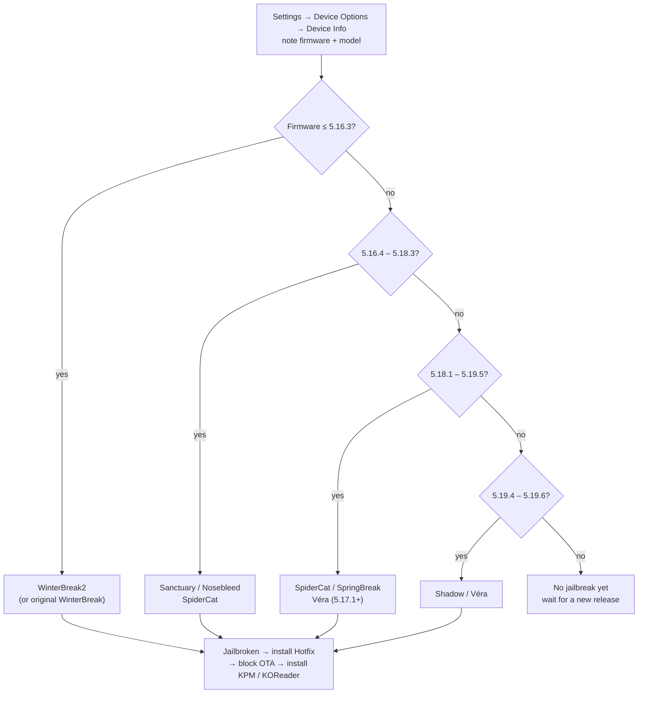

<div align="center">


# 🐧 Awesome Kindle

### The complete index for Kindle jailbreak, flashing & tinkering

**Every open-source, high-quality Kindle modding resource — in one place.**

[](https://awesome.re)
[](LICENSE)
[](#-contributing)


**🌐 Language:** **English** · [简体中文](README.md)

> **Jailbreaking just opens a door — it does not replace your firmware.**
> Behind that door you can run [KOReader](https://github.com/koreader/koreader), a terminal, Alpine Linux, or even Android — while the Kindle Store, Kindle Unlimited and every built-in feature keep working exactly as before.

[🚀 Which jailbreak?](#-which-jailbreak-should-i-use) · [🔓 All jailbreaks](#-jailbreak-overview) · [🧰 Post-jailbreak](#-post-jailbreak-toolkit) · [🧱 Firmware & recovery](#-firmware--recovery) · [📱 Device matrix](#-device-matrix) · [❓ FAQ](#-faq--troubleshooting)

</div>

---

## 📖 Contents

- [What is this](#-what-is-this)
- [📌 Read this first](#-read-this-first)
- [🚀 Which jailbreak should I use](#-which-jailbreak-should-i-use)
- [🔓 Jailbreak overview](#-jailbreak-overview)
- [📋 Pre-jailbreak checklist](#-pre-jailbreak-checklist)
- [🧩 Jailbreak deep dives](#-jailbreak-deep-dives)
  - [WinterBreak2](#winterbreak2)
  - [WinterBreak](#winterbreak)
  - [SpiderCat](#spidercat)
  - [Véra](#véra)
  - [Nosebleed](#nosebleed)
  - [Sanctuary](#sanctuary)
  - [SpringBreak (WinterBreak3)](#springbreak-winterbreak3)
  - [Shadow](#shadow)
  - [AdBreak](#adbreak)
  - [LanguageBreak & legacy](#languagebreak--legacy)
- [🧰 Post-jailbreak toolkit](#-post-jailbreak-toolkit)
  - [The essentials: Hotfix / KPM / Jobman](#-the-essentials-hotfix--kpm--jobman)
  - [KOReader: the must-have](#-koreader-the-must-have)
  - [Terminal / SSH / Linux](#-terminal--ssh--linux)
  - [The legacy KUAL / MRPI stack](#-the-legacy-kual--mrpi-stack)
- [📚 Reading & library tools](#-reading--library-tools)
- [🎮 Apps & games](#-apps--games)
- [🛠️ Power-user playbooks](#️-power-user-playbooks)
- [🧑‍💻 Developer resources](#-developer-resources)
- [🧱 Firmware & recovery](#-firmware--recovery)
- [📱 Device matrix](#-device-matrix)
- [❓ FAQ / troubleshooting](#-faq--troubleshooting)
- [🌐 Community](#-community)
- [🤝 Contributing](#-contributing)
- [🙏 Credits](#-credits)
- [📄 License](#-license)

---

## 🔎 What is this

A **continuously updated, bilingual index** of Kindle jailbreak, flashing and tinkering resources. It gathers:

- 🔓 **Every mainstream open-source jailbreak**, mapped precisely to device model + firmware
- 🧰 **The full post-jailbreak ecosystem**: package managers, hotfixes, readers, terminals, Linux, Android
- 📚 **Quality open-source apps & tools**: reading, library management, conversion, notes, audio, games
- 🧱 **Firmware & recovery**: firmware downloads, downgrades, serial flashing, factory reset
- 🧑‍💻 **Developer entry points**: SDK, cross-compilation toolchain, scriptlets, system docs

> [!NOTE]
> This repo is an **index and navigation hub**. It does not host pirated books, firmware, or closed-source commercial software. Every tool links to its official repository or wiki.
> Everything here defers to the [official KindleModding Wiki](https://kindlemodding.org/) and the [Jailbreak Wizard](https://kindlemodding.org/jailbreak-wizard.html). **If this list ever conflicts with the official docs, the official docs win.**

---

## 📌 Read this first

> [!WARNING]
> Jailbreaking carries risk. **Flashing, downgrading and serial work are high-risk** and can brick your device. Always:
> 1. Confirm your **model + firmware** is supported via the [Jailbreak Wizard](https://kindlemodding.org/jailbreak-wizard.html);
> 2. Read the relevant jailbreak page **in full**;
> 3. **Never** factory-reset, downgrade or unplug before you understand the steps;
> 4. Ask the official Discord / r/kindlejailbreak when stuck — don't wing it.

A few hard truths that save 90% of the pain:

| Myth | Reality |
| --- | --- |
| "Jailbreaking = installing a new OS" | ❌ It only grants **permission to run external code**, like Android root or iOS jailbreak. It is a process, not a firmware, and you cannot "install" it. |
| "Jailbreaking gives me free books" | ❌ Jailbreaking and piracy are unrelated. It **cannot** make store books free. |
| "I'll just upgrade, then downgrade later" | ❌ **Without a jailbreak you cannot downgrade.** Firmware only goes up (unless already jailbroken or using serial). |
| "My jailbreak survives an update" | ❌ OTA updates **wipe the jailbreak**. Install the Hotfix and **block auto-updates** afterwards. |
| "Which jailbreak is best?" | ⚖️ They are all equivalent — different methods for different firmwares. You never "upgrade" a jailbreak; you use whichever currently applies. |
| "I'll buy a new Kindle just to jailbreak it" | ⚠️ Risky: a fresh unit may ship on **unbreakable firmware**. Check the version first. |

---

## 🚀 Which jailbreak should I use

**The only authoritative source 👉 [kindlemodding.org/jailbreak-wizard](https://kindlemodding.org/jailbreak-wizard.html)**
(Enter serial / model + firmware and it tells you exactly which method to use.)

Simplified decision flow (for intuition only — **always trust the Wizard**):



> [!TIP]
> - **Ad-supported devices** (lockscreen ads) may need [AdBreak](https://kindlemodding.org/jailbreaking/AdBreak/) on some firmware.
> - **5.18.1 and above**: the old WinterBreak / Mesquito stack **no longer works** — use SpiderCat / SpringBreak / Véra / Shadow.
> - The **Scribe 3, Scribe Colorsoft, 2026 Kindle and 2026 Paperwhite** currently have **no jailbreak**.

---

## 🔓 Jailbreak overview

> Compiled from the official [KindleModding `jailbreaks.json` compatibility matrix](https://kindlemodding.org/jailbreaks.json) (subject to change).
> "Needs account" = requires an Amazon login; "Ads" = only works on devices with Special Offers.

| Method | Firmware | Models | Account | Ads | Status | Links |
| --- | --- | --- | :---: | :---: | :---: | --- |
| **WinterBreak2** | ≤ 5.16.3 (also 5.16.5) | PW / PW2 / KV / KT2 / PW3 / KOA / KT3 / KOA2 / PW4 / KT4 / KOA3 / PW5 / KT5 / KS | No | No | ✅ Active | [Wiki](https://kindlemodding.org/jailbreaking/WinterBreak2/) · [Repo](https://github.com/KindleModding/Winterbreak2) |
| **WinterBreak** | 5.16.2.1.1 – 5.17.x (< 5.18.1) | Above, plus PW6 / KS2 / CS | **Yes** | No | ✅ Active | [Wiki](https://kindlemodding.org/jailbreaking/WinterBreak/) · [Repo](https://github.com/KindleModding/WinterBreak) |
| **SpiderCat** | 5.16.3 – 5.19.5 | PW4 / KT4 / KOA3 / PW5 / KT5 / KT6 / PW6 / CS / KS / KS2 | No | No | ✅ Active | [Wiki](https://kindlemodding.org/jailbreaking/SpiderCat/) · [Repo](https://github.com/KindleModding/SpiderCat) |
| **Véra** | 5.17.1 – 5.20.2 | PW5 / KT5 / KT6 / PW6 / CS / KS / KS2 | No | No | ✅ Active | [Wiki](https://kindlemodding.org/jailbreaking/Vera/) |
| **Nosebleed** | 5.16.4 – 5.18.6 (KT5/PW5/KOA3)<br/>5.16.4 – 5.17.1.0.4 (PW6/KT6) | KT5 / PW5 / KOA3 / PW6 / KT6 | No | No | ✅ Active | [Wiki](https://kindlemodding.org/jailbreaking/Nosebleed/) |
| **Sanctuary** | 5.16.4 – 5.18.3 (denies 5.16.5) | PW4 / KT4 / KOA3 / PW5 / KT5 / KS / KT6 / PW6 / KS2 / CS | No | No | ✅ Active | [Wiki](https://kindlemodding.org/jailbreaking/Sanctuary/) |
| **SpringBreak** (WinterBreak3) | 5.18.1 – 5.19.2.0.1 (KT5/PW5)<br/>5.18.1.1.1 (KT4/PW4) | KT5 / PW5 / KT4 / PW4 | **Yes** | No | ✅ Active | [Wiki](https://kindlemodding.org/jailbreaking/SpringBreak/) · [Repo](https://github.com/KindleModding/SpringBreak) |
| **Shadow** | 5.19.4 – 5.19.6 | KS / KS2 / CS / PW6 / KT6 | No | No | ✅ Active | [Wiki](https://kindlemodding.org/jailbreaking/Shadow/) · [Repo](https://github.com/KindleModding/Shadow) |
| **AdBreak** | 5.18.1 – 5.18.5.0.1 | PW4 / KT4 / KOA3 / PW5 / KT5 / KS / KT6 / PW6 | **Yes** | **Ads only** | 🧪 Experimental | [Wiki](https://kindlemodding.org/jailbreaking/AdBreak/) · [Repo](https://github.com/KindleModding/AdBreak) |
| **LanguageBreak** | ≤ 5.16.2.1.1 | Older mainstream models | No | No | 🗄️ Archived | [Wiki](https://kindlemodding.org/jailbreaking/Legacy/LanguageBreak.html) · [Repo](https://github.com/KindleModding/LanguageBreak) |
| **NiLuJe K2/K4/K5** | 2.x / 4.x / 5.0.x | K2 / DX / K3 / K4 / KT | No | No | 🗄️ Classic | [Legacy](https://kindlemodding.org/jailbreaking/Legacy/index.html) |
| **Android flash** | — | Select models / Kindle × Migu | — | — | 🧪 Hardcore | [Guide](https://github.com/Ooonana/Guide-to-installing-android-on-kindle) |

---

## 📋 Pre-jailbreak checklist

Do these in order — they save your device:

1. **Check firmware**: `Settings → Device Options → Device Info`; note the exact version (e.g. `5.16.2.1.1`) and model code.
2. **Fill the Kindle (block auto-updates)**: jailbreaks often require Wi-Fi, and an OTA can kill the process mid-way. Fill storage with large files, or follow [Prevent Automatic Updates](https://kindlemodding.org/jailbreaking/prevent-auto-update/).
3. **Turn off Wi-Fi / enable airplane mode** during critical steps unless the method requires a connection.
4. **Delete any `.bin` update files** in the root after jailbreaking, so a reboot won't auto-install.
5. **Re-verify with the official Wizard**: model + firmware must match exactly; even a tiny version gap can fail.
6. **(Optional) Back up**: see [Backing Up](https://kindlemodding.org/jailbreaking/Legacy/backing-up/index.html) for old models; new models keep books in the cloud and jailbreaking doesn't touch user data.
7. **Charge fully + use a reliable cable**: never lose power mid-flash.

---

## 🧩 Jailbreak deep dives

> Each section covers "how it works + key steps + gotchas". **Always follow the full official wiki for the real walkthrough.**

### WinterBreak2

- **How it works**: exploits the built-in browser / book parser to escalate privileges, **without the Mesquito framework**.
- **Scope**: ≤ 5.16.3 (also accepts 5.16.5), covering everything from PW to Colorsoft.
- **Key steps**:
  1. Extract `wb2.zip` into the Kindle root (ensure a `winterbreak2` folder appears);
  2. Open the Experimental Browser and visit `https://penguins184.xyz/wb2`;
  3. Tap **Jailbreak** and wait for completion;
  4. Delete filler files and any `.bin` update files.
- **Gotchas**: if the page won't load, check Wi-Fi; if the button does nothing, `wb2.zip` probably wasn't extracted to root.
- 🔗 [Official guide](https://kindlemodding.org/jailbreaking/WinterBreak2/) · [Repo](https://github.com/KindleModding/Winterbreak2)

### WinterBreak

- **How it works**: the classic New Year's Day 2025 release built on **Mesquito**, triggered via crafted books / pages.
- **Scope**: `5.16.2.1.1` up to (but excluding) `5.18.1`. Requires a **registered Amazon account**.
- **Key steps**: download the official release → copy per the wiki → trigger on device → install Hotfix.
- **Gotchas**: the "old but stable" route. If you're ≤ 5.16.3, try WinterBreak2 first, then fall back.
- 🔗 [Official guide](https://kindlemodding.org/jailbreaking/WinterBreak/) · [Repo (1.6k★)](https://github.com/KindleModding/WinterBreak)

### SpiderCat

- **How it works**: a Jan-2026 method that sideloads a **crafted "book"** to trigger a browser/renderer exploit — very broad coverage.
- **Scope**: `5.16.3 – 5.19.5`, covering nearly every mainstream model since 2018 (including Colorsoft and Scribe 2024).
- **Key steps**:
  1. Download the SpiderCat book (USB sideload or on-device);
  2. Open the book in your library and follow the on-screen prompts;
  3. Continue to "What's Next" to install Hotfix / KPM.
- 🔗 [Official guide](https://kindlemodding.org/jailbreaking/SpiderCat/) · [Repo](https://github.com/KindleModding/SpiderCat)

### Véra

- **How it works**: pure **browser-driven** — open `kindlemodding.org/vera` on the Kindle, download the model+firmware "book", and trigger a renderer exploit.
- **Scope**: `5.17.1 – 5.20.2`, models PW5 / KT5 / KT6 / PW6 / CS / KS / KS2.
- **Key steps**:
  1. Note the exact firmware version;
  2. Open the Web Browser and visit `https://kindlemodding.org/vera`;
  3. Pick model + firmware, download the **Font Calibration** and the **model-specific Véra book**;
  4. Close the browser, wait 2–3 seconds, then tap the matching book to trigger;
  5. Install the Hotfix afterwards.
- **Gotchas**: if your firmware isn't listed, try the nearest version (not guaranteed) and ask in Discord.
- 🔗 [Official guide](https://kindlemodding.org/jailbreaking/Vera/)

### Nosebleed

- **How it works**: a March-2026 method — drop specific files into the root and trigger the exploit on-device.
- **Scope**: `5.16.4 – 5.18.6` (KT5/PW5/KOA3); `5.16.4 – 5.17.1.0.4` (PW6/KT6).
- **Key steps**: extract `nosebleed.zip` → copy the two files to the Kindle root → trigger per the wiki.
- 🔗 [Official guide](https://kindlemodding.org/jailbreaking/Nosebleed/)

### Sanctuary

- **How it works**: leverages a local privilege-escalation bug in the system **"Help" menu** — the gentlest interaction of all.
- **Scope**: `5.16.4 – 5.18.3` (denies 5.16.5), PW4 and many others (tested on 5.18.1.1.1).
- **Key steps**: open the Help menu → tap **Getting Started** → a success message appears (app error dialogs are normal) → install Hotfix.
- **Gotchas**: you must enter the device ID correctly; no text usually means a wrong ID (letters auto-uppercase).
- 🔗 [Official guide](https://kindlemodding.org/jailbreaking/Sanctuary/)

### SpringBreak (WinterBreak3)

- **How it works**: the third WinterBreak generation — creates **thousands of nested folders** to exhaust storage and trigger the exploit.
- **Scope**: KT5 / PW5 → `5.18.1 – 5.19.2.0.1`; KT4 / PW4 → `5.18.1.1.1`. Requires a **registered account**.
- **Key steps**: download `springbreak.zip` → extract and copy → run the on-device trigger → clean up immediately.
- **Gotchas**: **don't fill storage**, **avoid Wi-Fi**, and move fast — the nested folders need free space; if it runs out, it fails. There's a [technical write-up](https://penguins184.xyz/blog/springbreak-jailbreak/).
- 🔗 [Official guide](https://kindlemodding.org/jailbreaking/SpringBreak/) · [Repo](https://github.com/KindleModding/SpringBreak)

### Shadow

- **How it works**: an **MTP-protocol** jailbreak — run an official desktop app (Windows / Linux / macOS) that talks to the device over USB.
- **Scope**: `5.19.4 – 5.19.6`, models KS / KS2 / CS / PW6 / KT6.
- **Key steps**:
  1. Note the 10-digit build number from `Device Info`;
  2. **Close anything that mounts the Kindle** (Win: Explorer; Linux: `killall kiod6 kiod5 gvfsd-mtp`; macOS: `killall ptpcamerad`);
  3. Run `shadow-*` as admin/root, enter the build number, follow prompts;
  4. Install the Hotfix.
- 🔗 [Official guide](https://kindlemodding.org/jailbreaking/Shadow/) · [Repo](https://github.com/KindleModding/Shadow)

### AdBreak

- **How it works**: an experimental method specifically for **ad-supported (Special Offers)** devices, abusing ad-service components.
- **Scope**: `5.18.1 – 5.18.5.0.1` (PW4/KT4 only 5.18.1). **No Colorsoft or Scribe support.** Needs an account and an active ad state.
- **Key steps**: enable Special Offers in your Amazon account, sync so ads appear → run AdBreak → install Hotfix.
- 🔗 [Official guide](https://kindlemodding.org/jailbreaking/AdBreak/) · [Repo](https://github.com/KindleModding/AdBreak)

### LanguageBreak & legacy

- **LanguageBreak**: for `≤ 5.16.2.1.1`, now archived — still useful as history.
- **NiLuJe series**: the classic K2 / DX / DXG / K3, K4 and K5 jailbreaks — the "grandparent" methods for old devices.
- 🔗 [Legacy overview](https://kindlemodding.org/jailbreaking/Legacy/index.html) · [LanguageBreak](https://kindlemodding.org/jailbreaking/Legacy/LanguageBreak.html)

---

## 🧰 Post-jailbreak toolkit

After a successful jailbreak, the system auto-installs update-blocking and a package manager. Here's what you need to know.

### 🧩 The essentials: Hotfix / KPM / Jobman

| Tool | What it does | Link |
| --- | --- | --- |
| **Hotfix** | The jailbreak hotfix — blocks OTA from wiping your jailbreak and prevents bricks. **Install it first.** | [KindleModding/Hotfix](https://github.com/KindleModding/Hotfix) |
| **KPM** | Kindle Package Manager — install scriptlets on-device (like `apt`). | [KindleModding/KPM](https://github.com/KindleModding/KPM) · [Official repo source](https://github.com/KindleModding/repo) |
| **Jobman** | Jailbreak Manager — a GUI for managing the jailbreak and apps. | [KindleTweaks/jobman](https://github.com/KindleTweaks/jobman) |

**KPM basics** (type into the Kindle search bar):

```text
;kpm install        # install / browse available packages
;kpm update         # refresh the index
;kpm remove <pkg>   # uninstall
```

> **Scriptlets**: after jailbreaking, drop a `.sh` file into `documents/` and it appears in your library like a book — tap to run. Most Kindle apps ship this way. **Downloading `.sh` from untrusted sources is dangerous (malware / bricks); only install from trusted sources.**

### 📖 KOReader: the must-have

[koreader/koreader](https://github.com/koreader/koreader) (31k★) is the single most worthwhile open-source reader for Kindle: PDF / EPUB / DJVU / FB2 / MOBI and more, with deep typography, dictionaries, notes and cloud sync.

- Official install guide: [Getting KOReader](https://kindlemodding.org/jailbreaking/whats-next/getting-koreader/)
- On-device plugin store: [Storefront](https://github.com/ultimatejimmy/storefront.koplugin) (install plugins / fonts / screensavers without a PC)
- Beautiful UIs: [SimpleUI](https://github.com/doctorhetfield-cmd/simpleui.koplugin) (2k★), [Zen OS](https://github.com/xZenLabs/zen-os)
- Launch from the native library: [KOReaderIntegration](https://github.com/notmarek/KOReaderIntegration)

### 💻 Terminal / SSH / Linux

| Tool | Description | Link |
| --- | --- | --- |
| **kTerm** | E-ink-optimized terminal emulator with an on-screen keyboard. | [bfabiszewski/kterm](https://github.com/bfabiszewski/kterm) |
| **USBNetLite** | One command to enable SSH — turn the Kindle into a remote Linux box. | [notmarek/kindle-usbnetlite](https://github.com/notmarek/kindle-usbnetlite) |
| **Alpine Linux** | Run a full Alpine install and get a real package ecosystem. | [schuhumi/alpine_kindle](https://github.com/schuhumi/alpine_kindle) · [KUAL launcher](https://github.com/schuhumi/alpine_kindle_kual) |
| **Tailscale** | Mesh-networking so you can reach your Kindle from anywhere. | [mitanshu7/tailscale_kual](https://github.com/mitanshu7/tailscale_kual) |

### 🗂️ The legacy KUAL / MRPI stack

> [!NOTE]
> **KUAL** (Kindle Unified Application Launcher) and **MRPI** (MR Installer) are the **old** launcher/installer combo. On 5.16+ firmware KUAL is **largely obsolete**; new methods use **KPM + Scriptlets**.
> But if you tinker with **old models / old firmware**, the KUAL ecosystem is still useful.

- The original KUAL/MRPI resources live on [MobileRead · Kindle Developer's Corner](https://www.mobileread.com/forums/forumdisplay.php?f=150).
- Modern C++ rewrite: [kasparcode/kuala](https://github.com/kasparcode/kuala) (KUALA).
- Classic KUAL-dependent plugins: [LibrarianSync](https://github.com/barsanuphe/librariansync) (collection management), [BookFere-Tools](https://github.com/bookfere/BookFere-Tools) (a Chinese toolset).

---

## 📚 Reading & library tools

| Tool | Description | Link |
| --- | --- | --- |
| **KOReader** | Cross-platform open-source reader — the top pick after jailbreaking. | [koreader/koreader](https://github.com/koreader/koreader) |
| **KCC** (Kindle Comic Converter) | Convert comics / images / PDF to Kindle-friendly EPUB / MOBI / KFX, 6k★. | [ciromattia/kcc](https://github.com/ciromattia/kcc) |
| **WordDumb** | Calibre plugin generating local Word Wise and X-Ray files. | [xxyzz/WordDumb](https://github.com/xxyzz/WordDumb) |
| **Calibre** | The ebook manager: convert, metadata, send-to-device, all in one. | [kovidgoyal/calibre](https://github.com/kovidgoyal/calibre) |
| **Calibre-Web** | Self-hosted web library — read/download from a browser. | [janeczku/calibre-web](https://github.com/janeczku/calibre-web) |
| **KindleUnpack** | Unpack MOBI / AZW3 / KFX — essential for research and conversion. | [kevinhendricks/KindleUnpack](https://github.com/kevinhendricks/KindleUnpack) |
| **KindleFetch** | CLI that downloads books straight to the Kindle, no PC needed. | [justrals/KindleFetch](https://github.com/justrals/KindleFetch) |
| **KindleEar** | Aggregate RSS / web content and push it to the Kindle on a schedule. | [cdhigh/KindleEar](https://github.com/cdhigh/KindleEar) |
| **kindle2notion** | Export Kindle highlights and notes to Notion. | [paperboi/kindle2notion](https://github.com/paperboi/kindle2notion) |
| **BookFere-Tools** | Chinese-maintained KUAL plugin collection (CN-friendly). | [bookfere/BookFere-Tools](https://github.com/bookfere/BookFere-Tools) |

---

## 🎮 Apps & games

> All open-source / free, mostly shipped as **Scriptlets** or **KOPlugins**, installable via KPM or Storefront.

### 📝 Productivity / study

| App | Description | Link |
| --- | --- | --- |
| **KAnki** | Anki-based flashcards. | [crizmo/KAnki](https://github.com/crizmo/KAnki) |
| **RAnki** | Anki reviewer running the real Anki backend, with sync. | [crazy-electron/ranki](https://github.com/crazy-electron/ranki) |
| **KPomo** | Pomodoro focus timer. | [crizmo/KPomo](https://github.com/crizmo/KPomo) |
| **Textadept** | Desktop-grade text editor with Bluetooth-keyboard writing. | [kbarni/textadept-kindle](https://github.com/kbarni/textadept-kindle) |
| **Kreate** | Drawing app designed for e-ink. | [Foskya/Kreate](https://github.com/Foskya/Kreate) |
| **readinglog** | Track your reading time and stats. | [huangziwei/readinglog](https://github.com/huangziwei/readinglog) |
| **KOReader-On-Boot** | Auto-launch KOReader at boot. | [meepcat55/Kindle-KOReader-On-Boot](https://github.com/meepcat55/Kindle-KOReader-On-Boot) |

### 🎲 Games

| Game | Description | Link |
| --- | --- | --- |
| **KWordle** | Kindle Wordle. | [crizmo/KWordle](https://github.com/crizmo/KWordle) |
| **IllusionChess** | Fast chess. | [penguins184/IllusionChess](https://github.com/penguins184/IllusionChess) |
| **Gnome Games** | Chess + Minesweeper collection. | [crazy-electron/GnomeGames4Kindle](https://github.com/crazy-electron/GnomeGames4Kindle) |
| **Gambatte-K2** | Blazing-fast Game Boy / GBC / GBA emulator with Bluetooth audio. | [crazy-electron/gambatte-k2](https://github.com/crazy-electron/gambatte-k2) |
| **Crossword** | KOReader crossword plugin. | [roygbyte/crossword.koplugin](https://github.com/roygbyte/crossword.koplugin) |
| **KShips** | Battleship port. | [LOT-PL/KShips](https://github.com/LOT-PL/KShips) |
| **KindleCraft** | Run a Minecraft server on the Kindle (hard-float). | [gingrspacecadet/bareiron](https://github.com/gingrspacecadet/bareiron) |
| **KindleKraft** | Minecraft server launcher (soft-float). | [penguins184/KindleKraft](https://github.com/penguins184/KindleKraft) |

### 🎵 Audio

| App | Description | Link |
| --- | --- | --- |
| **KinAMP** | Bluetooth music player. | [kbarni/KinAMP](https://github.com/kbarni/KinAMP) |
| **LARK** | Audiobook player with covers and chapters. | [kbarni/LARKPlayer](https://github.com/kbarni/LARKPlayer) |

### 🖥️ Tinkering / geek

| Project | Description | Link |
| --- | --- | --- |
| **kindle-wall-display** | Turn a Kindle into a low-power wall display / photo frame rendering any PNG. | [jstriblet/kindle-wall-display](https://github.com/jstriblet/kindle-wall-display) |
| **hobby-kindle-http-file-server** | Run an HTTP file server on the Kindle. | [ngxson/hobby-kindle-http-file-server](https://github.com/ngxson/hobby-kindle-http-file-server) |
| **kindle-custom-screensaver** | Custom screensaver without KOReader or KUAL. | [chengandre/kindle-custom-screensaver](https://github.com/chengandre/kindle-custom-screensaver) |
| **kindle-weather-stand-alone** | Serverless Kindle weather display. | [x-magic/kindle-weather-stand-alone](https://github.com/x-magic/kindle-weather-stand-alone) |
| **KindleLazy** | Control the Kindle (keyboard, etc.) over USB. | [llakssz/KindleLazy](https://github.com/llakssz/KindleLazy) |
| **Kindle Click** | Turn a Kindle into a Bluetooth page-turner. | [Wiki](https://kindlemodding.org/kindle-hacking/pageturner.html) |

---

## 🛠️ Power-user playbooks

- **Flash Android**: replace the OS entirely on supported models — install apps, watch video. → [Guide](https://github.com/Ooonana/Guide-to-installing-android-on-kindle)
- **Run Alpine Linux**: a real Linux with `apk` package management. → [schuhumi/alpine_kindle](https://github.com/schuhumi/alpine_kindle)
- **Minecraft server**: repurpose an old Kindle as a low-power MC server. → [KindleCraft](https://github.com/gingrspacecadet/bareiron)
- **Wall clock / weather station**: a second life for aging Kindles. → [wall-display](https://github.com/jstriblet/kindle-wall-display)
- **Bluetooth-keyboard writing**: pair with Textadept as an e-ink typewriter. → [textadept-kindle](https://github.com/kbarni/textadept-kindle)
- **Remote SSH / mesh networking**: USBNetLite + Tailscale. → [usbnetlite](https://github.com/notmarek/kindle-usbnetlite) · [tailscale_kual](https://github.com/mitanshu7/tailscale_kual)
- **A big third-party app hub**: [KindleModShelf](https://kindlemodshelf.me/) — a community-curated app/tutorial aggregator.
- **Mesquite / WAF web apps**: build native-feeling Kindle UIs with HTML/CSS/JS. → [Penguins Wiki](https://github.com/penguins184/Penguins-Kindle-Wiki)

---

## 🧑‍💻 Developer resources

| Resource | Description | Link |
| --- | --- | --- |
| **KindleModding Wiki** | The most authoritative Kindle dev / jailbreak docs. | [kindlemodding.org](https://kindlemodding.org/) |
| **kindle-sdk** | Native Kindle compilation SDK. | [KindleModding/kindle-sdk](https://github.com/KindleModding/kindle-sdk) |
| **koxtoolchain** | Kindle / Kobo cross-compilation toolchain. | [KindleModding/koxtoolchain](https://github.com/KindleModding/koxtoolchain) |
| **jb.sh** | Self-contained unified jailbreak script. | [KindleModding/jb.sh](https://github.com/KindleModding/jb.sh) |
| **KPM package dev** | Build and publish your own KPM packages. | [Create a package](https://kindlemodding.org/kindle-dev/kpm/creating-a-package.html) · [Create a repo](https://kindlemodding.org/kindle-dev/kpm/creating-a-repository.html) |
| **Scriptlets** | How `.sh` apps work and how to write them. | [Scriptlets](https://kindlemodding.org/kindle-dev/scriptlets.html) |
| **GTK tutorial** | Build Kindle GUIs with GTK. | [Tutorial](https://kindlemodding.org/kindle-dev/gtk-tutorial/index.html) |
| **KindleTool** | Create / extract Kindle update packages. | [KindleModding/KindleTool](https://github.com/KindleModding/KindleTool) |
| **System services docs** | Per-service docs for every `com.lab126.*` service. | [Apps & Services](https://kindlemodding.org/kindle-apps-and-services/index.html) |
| **random.sh / utild / architect** | Utility scripts, a command service, and armel/armhf compatibility. | [random.sh](https://github.com/KindleModding/random.sh) · [utild](https://github.com/KindleModding/utild) · [architect](https://github.com/KindleModding/architect) |

---

## 🧱 Firmware & recovery

> [!WARNING]
> Firmware work is the highest-risk area. **Without a jailbreak you cannot downgrade**; a wrong flash can brick the device. For informed users only.

- **Manually download firmware**: [official guide](https://kindlemodding.org/firmware-and-flashing/downloading-updates.html) (grab the model-specific `.bin` from Amazon's official links).
- **Downgrade firmware**: [Downgrading](https://kindlemodding.org/firmware-and-flashing/downgrading/) (**requires a jailbreak**).
- **Force KV onto 5.14+**: [guide](https://kindlemodding.org/firmware-and-flashing/kv-flash-new-firmware.html).
- **Serial flashing / unbricking**: needs a `1.8V` USB-TTL adapter soldered to the serial pads — lets you **flash firmware directly, even Android**. → [Firmware & Flashing](https://kindlemodding.org/firmware-and-flashing/index.html)
- **Unbrick / factory reset**: [Kindle Recovery](https://kindlemodding.org/jailbreaking/faq/kindle-recovery.html) · [Recovering From a Reset](https://kindlemodding.org/jailbreaking/faq/recovering-from-a-reset.html)
- **Remove the jailbreak**: [Unjailbreaking](https://kindlemodding.org/jailbreaking/faq/unjailbreaking.html)
- **Bypass setup (OOBE)**: [Bypassing OOBE](https://kindlemodding.org/jailbreaking/faq/bypassing-oobe.html)

---

## 📱 Device matrix

> Model codes appear in `Device Info` or the serial number. Below maps common models to the "latest usable jailbreak" (**firmware on new devices may differ**).

| Year | Code | Model | Platform / Board | Jailbreak |
| --- | --- | --- | --- | --- |
| 2007 | K1 | Kindle 1st Gen | — | Legacy |
| 2009 | K2 / DX | Kindle 2 / DX | Mario / Nell | NiLuJe K2/DX/K3 |
| 2010 | K3 | Kindle Keyboard | Luigi | NiLuJe K2/DX/K3 |
| 2011 | K4 / KT | Kindle 4 / Kindle Touch | Yoshi | NiLuJe K4 / K5 |
| 2012 | PW | Paperwhite 5th | Wario | WinterBreak2 / WinterBreak |
| 2013 | PW2 | Paperwhite 6th | Wario | WinterBreak2 / WinterBreak |
| 2014 | KV / KT2 | Voyage / Kindle 7th | Wario | WinterBreak2 / WinterBreak |
| 2015 | PW3 | Paperwhite 7th | Wario | WinterBreak2 / WinterBreak |
| 2016 | KOA / KT3 | Oasis 8th / Kindle 8th | Duet / Heisenberg | WinterBreak2 / WinterBreak |
| 2017 | KOA2 | Oasis 9th | Zelda | WinterBreak2 / WinterBreak |
| 2018 | PW4 | Paperwhite 10th | Rex | Sanctuary / SpiderCat / SpringBreak / AdBreak |
| 2019 | KT4 | Kindle 10th | Rex | Sanctuary / SpiderCat / SpringBreak / AdBreak |
| 2019 | KOA3 | Oasis 10th | Zelda | Sanctuary / Nosebleed / SpiderCat |
| 2021 | PW5 | Paperwhite 11th | Bellatrix | Sanctuary / Nosebleed / SpiderCat / SpringBreak / Véra / AdBreak |
| 2022 | KT5 | Kindle 11th (2022) | Bellatrix | Sanctuary / Nosebleed / SpiderCat / SpringBreak / Véra / AdBreak |
| 2022 | KS | Scribe (2022) | Bellatrix3 | Sanctuary / SpiderCat / AdBreak |
| 2024 | KT6 / PW6 | Kindle 11th / Paperwhite 12th | Bellatrix | Nosebleed / SpiderCat / Shadow / Véra / AdBreak |
| 2024 | KS2 / CS | Scribe 2024 / Colorsoft | Bellatrix | SpiderCat / Shadow / Véra |
| 2025 | KS3 / KSC | Scribe 3 / Scribe Colorsoft | Platpa6 / Platcs8 | ❌ None |
| 2026 | KT7 / PW7 | Kindle 2026 / Paperwhite 2026 | Platpo8 / Platao5 | ❌ None |

> 📌 For the full model / serial / firmware mapping, see the [Models Table](https://kindlemodding.org/kindle-hacking/models-table.html) and the [Jailbreak Wizard](https://kindlemodding.org/jailbreak-wizard.html).

---

## ❓ FAQ / troubleshooting

<details>
<summary><b>Will jailbreaking brick my Kindle or lose my data?</b></summary>

Follow the official guides and the risk is low; jailbreaking does not touch your library (books live in the cloud). The real dangers are **an OTA interrupting the process**, **a mistaken factory reset**, and **careless firmware flashing**. So: fill storage, disable Wi-Fi, and install the Hotfix.
</details>

<details>
<summary><b>Do the Kindle Store / Kindle Unlimited still work?</b></summary>

Yes. Jailbreaking only grants permission to run external programs — store, KU and sync all keep working, exactly like Android root or iOS jailbreak.
</details>

<details>
<summary><b>My firmware has no jailbreak — what now?</b></summary>

**Wait for a new release** (Amazon keeps patching). Without a jailbreak you **cannot downgrade**, and there's no universal exploit. Watch the [Jailbreak Wizard](https://kindlemodding.org/jailbreak-wizard.html) and the official Discord.
</details>

<details>
<summary><b>I updated and lost my jailbreak?</b></summary>

OTA updates overwrite the jailbreak. That's why you must **install the Hotfix** and **block auto-updates** (fill storage / disable Wi-Fi / delete `.bin`). You usually need to re-jailbreak on the new firmware.
</details>

<details>
<summary><b>Is jailbreaking piracy?</b></summary>

No. They are independent: you can sideload pirated content without a jailbreak, and a jailbreak won't make store books free. This repo only indexes open-source tools and hosts no pirated material.
</details>

<details>
<summary><b>Can I jailbreak from Windows / macOS / Linux?</b></summary>

Most methods (SpiderCat / Véra / WinterBreak2) need only the Kindle itself + Wi-Fi; Shadow needs a desktop app (all three platforms); SpringBreak / Nosebleed need a PC to unzip and copy. Prepare per method.
</details>

<details>
<summary><b>KUAL doesn't work / does nothing?</b></summary>

On 5.16+ firmware KUAL is effectively obsolete — switch to **KPM + Scriptlets**. Only old models / old firmware still use KUAL + MRPI.
</details>

<details>
<summary><b>Where do I get help?</b></summary>

Prefer the official [KindleModding Discord](https://discord.kindlemodding.org/), then [r/kindlejailbreak](https://www.reddit.com/r/kindlejailbreak/) and the [MobileRead forum](https://www.mobileread.com/forums/forumdisplay.php?f=150). **Read the relevant wiki page first** — otherwise nobody will answer.
</details>

---

## 🌐 Community

| Resource | Description | Link |
| --- | --- | --- |
| **KindleModding Wiki** | Official docs / jailbreak guides (most authoritative). | https://kindlemodding.org/ |
| **Jailbreak Wizard** | Enter model + firmware to auto-match a jailbreak. | https://kindlemodding.org/jailbreak-wizard.html |
| **KindleModding Discord** | Official community, first stop for help. | https://discord.kindlemodding.org/ |
| **KindleTweaks Discord** | Another active community. | https://discord.gg/yWPHHbrp7h |
| **r/kindlejailbreak** | Reddit community. | https://www.reddit.com/r/kindlejailbreak/ |
| **MobileRead** | The oldest Kindle tinkering forum; birthplace of KUAL. | https://www.mobileread.com/forums/forumdisplay.php?f=150 |
| **KindleModShelf** | Third-party app / tutorial hub. | https://kindlemodshelf.me/ |
| **Penguins Kindle Wiki** | Mesquite / WAF web-app development. | https://github.com/penguins184/Penguins-Kindle-Wiki |
| **Awesome-Kindle** | Another great Kindle tool list (EN). | https://github.com/KindleTweaks/Awesome-Kindle |
| **Awesome E-Ink** | Curated e-ink resources. | https://github.com/asapelkin/awesome-eink |

---

## 🤝 Contributing

PRs are welcome — help make this index more complete and accurate.

1. **Fork** this repo and create a branch;
2. New entries must be **open-source / free / working**, with a **reachable official link**;
3. Put it in the right category and keep table columns aligned;
4. Open a PR and briefly explain why (e.g. new jailbreak / tool archived, needs marking).

> Broken link, outdated firmware range, or an unmaintained project? Open an Issue / PR to fix it.
> This repo indexes **tools and documentation only** — no pirated books, cracked firmware, or closed-source commercial software.

See [CONTRIBUTING.md](CONTRIBUTING.md) for the full guide.

---

## 🙏 Credits

Most of this index is built on the shoulders of these open-source / community projects:

- [KindleModding](https://github.com/KindleModding) and its [official wiki](https://kindlemodding.org/) — the source of truth for the compatibility matrix
- [KindleTweaks](https://github.com/KindleTweaks) and [Awesome-Kindle](https://github.com/KindleTweaks/Awesome-Kindle)
- The [KOReader](https://github.com/koreader/koreader) team and every plugin author
- The [MobileRead](https://www.mobileread.com/) community — the original tinkerers
- Every developer quietly maintaining open-source Kindle tools ❤️

> And everyone who wrote up their own mistakes so others could avoid them — you save the rest of us countless detours.

---

## 📄 License

Content (docs and index) is released under the [MIT License](LICENSE).
All indexed projects remain under their own licenses — please respect each project's terms.

<div align="center">

**⭐ If this index helps you, a Star is the best support ⭐**

<sub>Made with ❤️ for the Kindle modding community · Stay curious, flash carefully</sub>

</div>
