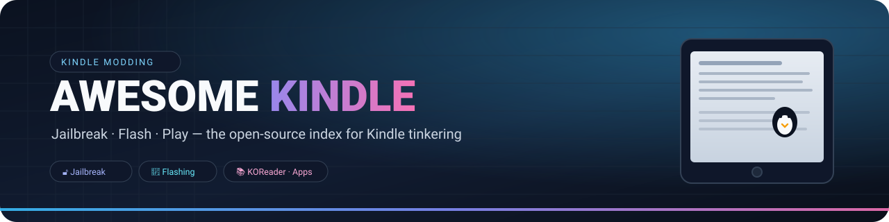

# 🐧 Awesome Kindle

### Kindle 脱獄・ファームウェア・カスタマイズ完全索引

**オープンソースで高品質な Kindle 活用リソースを一か所に。**

**🌐 言語：** [English](README_EN.md) · [简体中文](README.md) · **日本語** · [한국어](README_KO.md)

---

> これは **日本語のクイックガイド（要約）** です。完全な内容・表・手順は
> [English README](README_EN.md) と [简体中文 README](README.md) を参照してください。

## 🚀 クイックスタート（5 分）

1. **機種とファームウェアを確認**：設定 → 端末オプション → 端末情報。
2. **自動アップデートを止める**（ストレージを満杯にする / OTA ブロック）。
3. [Jailbreak Wizard](docs/wizard.html) で機種＋ファームウェアを入力し、対応する脱獄を確認。
4. 公式 Wiki（[kindlemodding.org](https://kindlemodding.org/)）の手順どおりに実行。
5. 成功したらすぐ **Hotfix** → **KPM** → **KOReader** を導入。

## 📚 主なセクション

- 🔓 **脱獄**：[全手法の手順](docs/jailbreaks/README.md)
- 🧰 **ガイド**：[導入・変換・トラブル対応](docs/guides/README.md) · [購入ガイド](docs/guides/buying-guide.md)
- 🔎 **検索サイト**：`docs/`（GitHub Pages）
- 🗂️ **無料・合法コンテンツ**：英/中の README を参照

## ⚠️ 注意

- 脱獄は自己責任。**ファームウェアを誤って書き換えると文鎮化**します。
- **公式 Wiki が常に最優先**。本リポジトリは索引であり、実行ファイルは配布しません。
