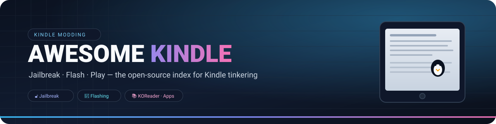

# 🐧 Awesome Kindle

### 킨들 탈옥 · 펌웨어 · 커스터마이징 완전 색인

**🌐 언어：** [English](README_EN.md) · [简体中文](README.md) · [日本語](README_JA.md) · **한국어**

---

> 이것은 **한국어 다이제스트(각 섹션 요약 + 링크)** 입니다. 표·전문·세부 내용은
> [English README](README_EN.md) / [简体中文 README](README.md) 를 참고하세요.

## 🚀 빠른 시작 (5분)
1. **기기와 펌웨어 확인**: 설정 → 기기 옵션 → 기기 정보.
2. **자동 업데이트 차단** (저장 공간 채우기 / OTA 차단).
3. [Jailbreak Wizard](docs/wizard.html) 에서 기기+펌웨어 입력 → 호환 탈옥 확인.
4. 공식 위키([kindlemodding.org](https://kindlemodding.org/)) 절차대로 실행.
5. 성공하면 즉시 **Hotfix** → **KPM** → **KOReader** 설치.

## 📊 지원 현황
- 현재 공개 방법이 지원하는 **최대 펌웨어는 5.20.2** (Véra). 그보다 최신이면 **공개 탈옥 없음 = 대기**.
- 2025–2026 Scribe 3 / Scribe Colorsoft / Kindle 2026 / Paperwhite 2026 은 **미지원**.
- 자세히: [Status board](docs/status.html).

## 📚 주요 섹션
- 🔓 **탈옥**: [모든 방법 단계별 안내](docs/jailbreaks/README.md)
- 🧰 **가이드**: [목록](docs/guides/README.md) — Starter Pack / KOReader / KPM / KCC / Calibre / SSH / 문제 해결 / 구매 / 노트 내보내기
- 🔎 **검색 사이트**: `docs/` (GitHub Pages)
- 🗂️ **무료·합법 콘텐츠**: 영문/중문 README 참고
- 🎮 **앱·게임 / 개발자 / 펌웨어·복구 / FAQ**: 영문/중문 README 참고

## ⚠️ 주의
- 탈옥은 자기 책임입니다. **펌웨어를 잘못 덮으면 벽돌**이 됩니다.
- **공식 위키가 항상 최우선**. 이 저장소는 색인이며 실행 파일을 배포하지 않습니다.
